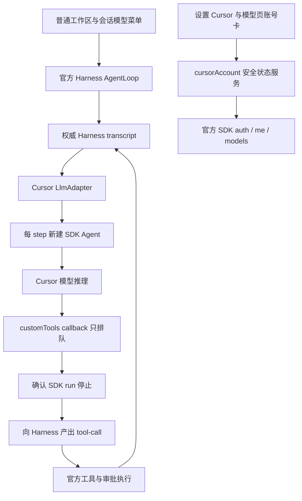

# Cursor LlmAdapter 架构与验收边界

`0.3.0` 将 Cursor 接入普通工作区与会话的模型菜单，撤下独立任务界面。官方 AgentLoop、工作区、历史、工具和审批始终由 Harness 管理。该架构已实现并通过 107 项离线测试，详细证据以 [verification.md](verification.md) 为准。

## 数据流与职责

Cursor 不接管 Host Agent factory，也不运行独立会话循环。LlmAdapter 将 SDK 推理结果转换为官方模型流式事件；Host 决定何时运行下一步和执行工具。SDK callback 不执行工具，不修改工作区；排队请求只有在确认 SDK run 停止后才交给 Host，停止失败不能继续执行工具或伪造成功。

每个 Harness step 新建 SDK Agent，不以 SDK checkpoint 或独立任务 store 作为历史权威。下一步将已执行工具的结果随完整 Host transcript 重新传入。这使官方会话历史与工具调用成为唯一执行依据。

## SDK 与工具隔离

SDK 配置限定 `tools: ["mcp"]`，`settingSources: []` 与 `mcpServers: {}`，只通过 customTools 提出工具请求，不加载原生读写/Shell 工具、用户设置来源或外部 MCP。实际工具、权限与审批由 Host 控制，不把 SDK 的工具事件再次作为已执行工具回放。

SDK `systemPrompt` 受账号 allowlist 限制，因此本版把带角色标签的完整 transcript 封装为单条 user payload。这不等价于原生 system/developer 语义，不能承诺相同指令层级。每步重传历史会增大上下文；完整 transcript 限制为 2 MiB，超限明确报错而不截断。跨模型切换保留文本历史，附件与图片明确拒绝。

本版为文本模式。`GenerateOptions` 的 `maxTokens`、`temperature`、`stop`、`reasoningEffort` 明确拒绝，不伪装支持参数上限。推理强度通过 Cursor 目录 variant 选择；普通 UI 跨模型切换清除旧推理选项。未支持交互必须明确报错，不用占位成功结果实现。流式事件、工具 ID 关联、取消屏障与异常清理须通过离线替身覆盖后才能宣称支持。

## 宿主与客户端集成

模型目录注册到 Host 的 Cursor 提供方，普通会话通过模型菜单选择。官方 AgentLoop、其他 providers、默认模型与预设保留；bundle patch 仅插入本插件。生产依赖只含 SDK/zod，Host/Cordis 包使用完整版本 peer 与 dev 依赖，并通过宿主共享 resolver 解析。

账号使用 `settings.section` 的 Cursor 菜单及模型页 footer，不依赖独立任务页面。`0.2.0` 的侧栏、任务页面及独立任务服务入口撤下；磁盘旧数据保留，不自动迁移到普通会话，也不视为普通会话恢复依据。

配置以空对象为默认，旧 `stateDirectory`、`permissionMode`、`sandboxEnabled` 等字段兼容但忽略。Host 的工作区与权限控制为准，不能从旧配置推断本版权限。

## 官方辅助任务限制

默认标题与压缩任务沿用最近普通 request route。标题传入 `maxTokens: 4096`，Cursor adapter 拒绝后，Host 回退为首条消息标题，不阻断聊天。压缩传入固定 `maxTokens`，Cursor 不支持：自动压缩记录警告后继续，但无法靠该压缩恢复超限上下文；手动压缩失败。

可由用户显式配置支持这些参数的非 Cursor 辅助模型：

| 官方插件                                                                             | 配置字段                                                    |
| ------------------------------------------------------------------------------------ | ----------------------------------------------------------- |
| `@deepseek-ai/dsh-session-title-first-prompt-llm`（patch 行 ID `session-title-llm`） | `config.provider`、`config.model`                           |
| `@deepseek-ai/dsh-compaction-basic`                                                  | `config.summarizationProvider`、`config.summarizationModel` |

字段值应使用账号已有可用模型。插件不自动修改 profile，不静默转向其他付费 provider；保留官方 AgentLoop 不代表默认 Cursor route 支持这两类辅助请求。

## 认证与安全边界

只使用 Cursor 官方公开 SDK 的 auth、me 与 models。凭据由 SDK 管理，不读取私有凭据文件结构，不向客户端、日志或会话输出 Key。环境变量凭据优先；退出只清除 SDK 保存凭据。本机 stored 状态不等于远端连接成功，连接成功要求 me 与 models 均成功。

Typert schema 不是出站脱敏器；宿主仍显式构造安全 DTO，原始 SDK 异常不直接传给客户端。取消、流式失败、停止未确认和卸载均须回收 SDK 资源，不能让待执行工具在错误后产生副作用。

## 验收状态

v0.3.0 的 adapter、模型流事件、工具停止屏障、取消与客户端集成已实现。`npm run check` 的契约生成、严格类型、格式、生产构建和 107 项离线测试全部通过，0 失败；0.2→0.3 隔离升级与真实 Host 模型路由激活已通过，具体记录见验证文档。

真实 Desktop、浏览器授权、账号模型及付费对话尚未验证。插件无需另装 Cursor 桌面应用或全局 SDK，但 SDK 托管组件仍有平台和登录条件；自动检查不修改真实 profile、不调用计费模型。
