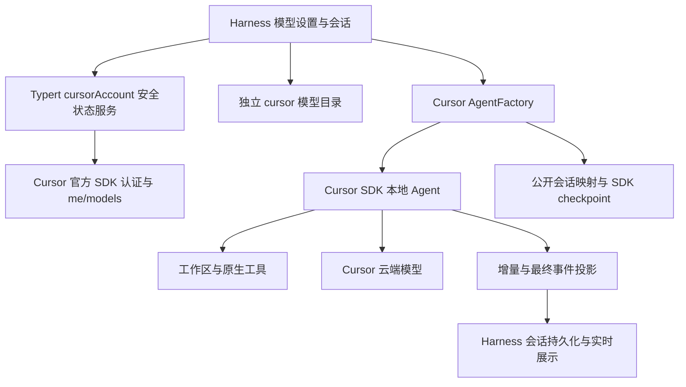

# Cursor 专用模式架构与验收边界

本方案依据 `research/` 的固定版本研究与官方 Harness 源码。`0.1.0` 已实现专用 Cursor 原生 Agent MVP；实现、离线自动验证和真实账号实测分别记录，不互相替代。

## 数据流与职责

Cursor 管理 Agent 循环与工具执行。Harness 的工具记录仅用于展示，不二次执行。`cursor` 是独立提供方，不占用 DeepSeek namespace，也不提供伪造的通用 LLM 补全。

## 专用 profile 模式

Harness 只有一个创建 factory。bundle patch 停用默认 `agent-loop`、`session-title-llm`、`plan-mode`、`compaction-basic` 及 `llm-deepseek`、`llm-deepseek-account`、`llm-pi-ai`；设置默认提供方为 `cursor`、模型为 `default`。模型设置页与原账号配置数据保留。

补丁合成不原地修改基底配置。删除 bundle 层后恢复原配置，实际用户操作是卸载插件并重启；仅关闭宿主开关不足以移除 bundle patch。新实例建议采用专用验证 profile，已有非 Cursor 会话无法通过创建空 Cursor Agent 冒充恢复。

## 契约与生命周期

| Harness 入口               | Cursor 对应            | 实现边界                                                |
| -------------------------- | ---------------------- | ------------------------------------------------------- |
| `AgentFactory.createAgent` | `Agent.create`         | 工作区规范化、会话持久化handle、映射与发布事务          |
| `resume`                   | `Agent.resume`         | 校验版本、工作区、权限、store与checkpoint，缺失明确失败 |
| Agent 消息                 | `agent.send`           | 文本输入、单会话排队、唯一消息ID与多轮同Agent           |
| `cancel`                   | `run.cancel`/`wait`    | 创建、send、stream与结束竞态，迟到资源回收与有限等待    |
| `agent/assistant-stream`   | `onDelta`              | attempt/revision递增、delta/final去重                   |
| 会话/工具事件              | `run.stream`/`wait`    | 工具只展示，最终committed先等待持久化                   |
| `cursor` 模型目录          | `Cursor.models.list`   | 动态目录与变体参数，拒绝通用补全                        |
| `cursorAccount`            | `auth`、`me`、`models` | 登录、取消、刷新、退出、流式安全快照                    |

Typert Host 与 Client 由官方生成器生成。流式客户端方法直接返回可异步迭代的 `RemoteStreamHandle`，不会套上 Promise 或 unary result。传输schema不是出站脱敏器；宿主显式构造安全DTO，SDK原始异常不会直接进入客户端。

认证本机 stored 状态与连接成功区分：连接成功需要远端 `me` 和 `models` 均成功。环境变量凭据优先；退出只清除 SDK 保存凭据。凭据由官方 SDK 管理，插件不读取私有凭据结构，不持久化或展示 Key。

运行时停止新请求、取消活动事务/运行、排空持久化并释放注册。SDK的网络和存储操作存在不可取消边界；取消以epoch和资源回收守卫防止迟到结果覆盖新状态。无限挂起的SDK不会被伪装成成功终止；运行收尾超时后停止复用该Agent。

## 状态与限制

账号服务、客户端、目录、factory、流式投影、多轮、取消、恢复和Git预编译构建已有实现。自动验证使用真实Harness服务/生成契约及离线SDK替身，具体命令和结果见 [verification.md](verification.md)。

文本之外的图片输入、分叉、Harness 子Agent、steer/inject、人工交互审批响应与maintenance/压缩尚不支持，入口明确拒绝。默认只读工具和SDK沙箱配置不等于已经在Windows实测执行。

真实浏览器授权、真实账号模型、付费对话、SDK沙箱运行、用户Desktop完整流程尚未执行。用户验收步骤保留在验证记录中；本次自动检查不会修改现有profile或调用计费模型。
