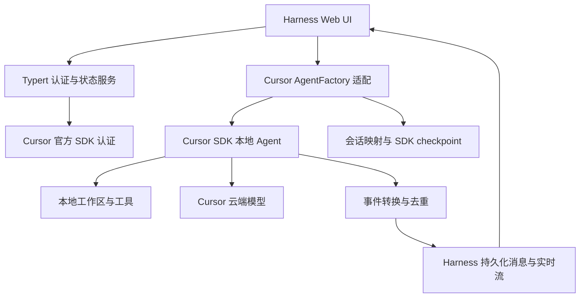

# 接入方案与分阶段验收

本方案基于 2026-10-22 的[Harness 研究](research/deepseek-harness.md)和[SDK 研究](research/cursor-sdk.md)。这是设计与实施计划，不是已完成能力列表。

## 1. 决策

采用 Cursor 原生 Agent 模式：Harness 提供 Web UI、会话展示和生命周期入口，Cursor 管理 Agent 循环与实际工具执行。

只读/写入/Shell 权限由适配层与 Cursor 可执行的策略共同控制。Harness UI 中存在某个审批选项，不代表 Cursor 就能执行同样的审批流程。

## 2. 接口映射

| Harness 侧                 | Cursor 侧                          | 适配责任                                   |
| -------------------------- | ---------------------------------- | ------------------------------------------ |
| `AgentFactory.createAgent` | `Agent.create({ local: { cwd } })` | 资源归属、工作区校验、创建后写映射         |
| `AgentFactory.resume`      | `Agent.resume(agentId, options)`   | 使用固定 store，校验工作区及版本，配置重建 |
| Agent 消息入口             | `agent.send(message, options)`     | 单会话排队、避免重复提交                   |
| `cancel`                   | `run.cancel()`                     | 处理创建中取消、结束竞态及清理             |
| `agent/assistant-stream`   | `onDelta`                          | 实时增量、attempt/revision、去重           |
| Session 消息/工具记录      | `run.stream()`、`run.wait()`       | 持久化先于 committed end；工具只展示       |
| 模型选择器                 | `Cursor.models.list()`             | 实时目录与参数映射，不能充当通用补全接口   |
| 登录 UI（待开发）          | `Cursor.auth.login/status/logout`  | 登录URL与安全状态；不传递 Key              |

`followup/steer/inject/runMaintenance` 不能从 SDK `send` 自动推导等价实现。下一阶段应逐项确定语义；不支持的操作必须明确报告，不可返回假成功。

## 3. 持久化与退出

建议保存带 schemaVersion 的独立映射记录，至少含 DSH session ID、Cursor agent ID、规范化 workspace、SDK store 位置与创建配置版本。Cursor checkpoint 和映射必须一致。缺失或不匹配时拒绝伪恢复，不静默新建会话。

登录信息只由 SDK 管理，不能写入 session mapping。SDK 本地状态、模型请求状态与 Harness UI 状态分别记录和解释。

卸载按顺序处理：停止新请求、取消登录/运行、等待活动任务结束、排空持久化、释放 SDK/Context、移除注册。要验证取消发生在 create/send/stream/持久化边界时均可收尾。

## 4. 分阶段验收

### 阶段 0：本次初始化

- Cordis 插件能装载和卸载，补丁只插入自己的入口。
- 官方认证薄包装及 login/status/logout CLI。
- 登录结果不泄露 API Key，取消信号可以向 SDK 传递。
- TypeScript 严格检查、离线测试、构建与本地打包。
- 保存两边接口与实现边界。

### 阶段 1：只读原生 Agent 验证

- 采用同版本 Harness 包实现完整 AgentFactory 生命周期，在专用 profile 中替换默认 loop。
- 显式受限工具配置，完成一次只读对话和取消。
- UI 增量展示和持久消息一致，无重复文本、重复工具执行。
- 所有资源在取消和卸载后释放；不支持的交互操作给出明确错误。

### 阶段 2：持续会话与工具

- 动态模型目录、参数与多轮对话。
- 关闭进程后恢复相同 Cursor Agent，缺 checkpoint 时明确失败。
- 独立验证写入、Shell、Windows 沙箱行为，不用 autoReview 替代强制限制。
- 未支持的用户审批请求明确终止，界面不宣称已经支持审批。

### 阶段 3：Harness 内登录

- 按当前 Typert 协议提供登录开始、取消、状态与退出接口。
- 生成兼容 Harness 的客户端模块，使用设置扩展点展示状态。
- 客户端和日志无法取得 Key；重复登录、取消、超时和多窗口行为可预测。

### 后续

图片输入、MCP/Skills 配置、Diff、子 Agent、多工作区及远程访问按真实需求逐项验证。已有方案声称支持某项能力，不计作本项目验收通过。

## 5. 不在初始化中承诺的能力

当前没有完整 Web 集成、Cursor 模型调用或原生 Agent 执行，也没有修改用户的 Harness profile、Cursor 登录或远端仓库。真实认证、账号模型目录、工具执行和 CI 云端运行都需要后续实测。
