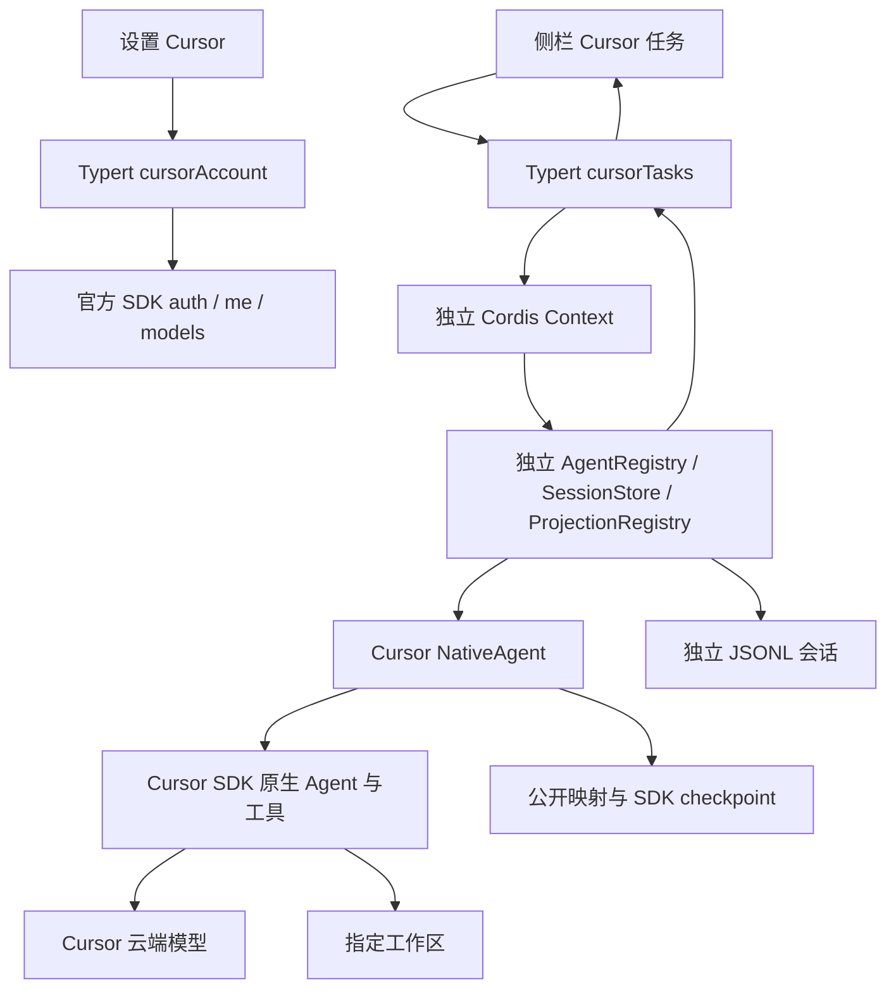

# Cursor 独立任务架构与验收边界

`0.2.0` 从专用 Cursor 模式转为独立任务模式。接口依据为 `research/` 的固定版本研究与官方 Harness 源码。实现、离线验证与真实账号实测分别记录；最终验收以 [verification.md](verification.md) 为准。

## 数据流与职责

宿主只注册账号和任务远程服务；独立 Context 内复用 NativeAgent、AgentRegistry、SessionStore、ProjectionRegistry 与官方 JSONL 持久化组件。该域不向宿主全局 Agent 注册 factory，也不向全局 LLM 注册 Cursor provider。官方会话、模型提供方、默认模型和 Agent loop 保留原有行为。

Cursor 管理 Agent 循环与工具执行。工具事件只投影为记录，不进入 Harness 工具执行入口。客户端通过公开 `sidebar.panellist` 与 keyed `main` 插槽展示任务；账号通过 `settings.section` 的 Cursor 菜单及模型页 footer 展示。

## 安装与作用域

`0.1.1` 为解决全局单 factory 冲突而停用官方循环与 providers，导致官方模型消失。`0.2.0` 的 bundle patch 仅插入插件，不修改基底官方配置。生产依赖仅为 Cursor SDK 与 zod；Harness/Cordis 包使用完整版本 peer 与 dev 依赖，运行时通过宿主共享 resolver 解析，避免复制宿主包造成预设作用域冲突。

Git 安装使用已提交的 `dist/` 与生成的 `lib/`，不通过 `prepare` 等安装生命周期构建。升级在退出 Desktop 后重新添加固定版本，无需先卸载或重配官方账号；旧 Cursor 任务恢复仍须通过原有映射与 checkpoint 校验。

## 契约与生命周期

| 入口                               | 行为与边界                                                         |
| ---------------------------------- | ------------------------------------------------------------------ |
| `cursorAccount`                    | 公开 SDK auth、me、models；登录、取消、刷新、退出及安全快照        |
| `cursorTasks.listModels/listTasks` | 动态 Cursor 模型及本域任务目录；不读取官方聊天                     |
| `create`                           | 校验绝对工作区路径及模型，创建本域任务；不发送提示词               |
| `send`                             | 文本多轮，复用 NativeAgent，运行中拒绝重叠发送                     |
| `watch/snapshot`                   | revision 与安全 DTO；增量文本、思考及最终消息、工具记录            |
| `cancel`                           | 使用 attempt 标识避免迟到取消误伤后续运行，等待 SDK 收尾           |
| `resume`                           | 本域任务标识、工作区、权限、store 与 checkpoint 校验；缺失明确失败 |
| `dispose`                          | 关闭订阅，停止接收请求，取消及回收活动运行，释放独立域             |

Typert Host 与 Client 使用官方生成器。流式客户端返回可异步迭代的 `RemoteStreamHandle`。传输 schema 不承担出站脱敏：宿主逐字段构造 DTO，不向客户端传递 SDK 实例、凭据或原始异常。任务服务限制并发请求与订阅，文本输入最长十万字符。

默认任务状态目录为 `profile.dir/cursor-agent/tasks`，其内分别保存映射、独立 JSONL 会话和 SDK checkpoint。账号凭据始终由官方 SDK 管理，不读取其私有文件结构，不保存或展示 Key。本机 stored 状态与连接成功区分；连接成功要求远端 me 与 models 均成功。

SDK 网络与存储存在不可取消边界，运行时使用 epoch、终态等待和迟到资源回收守卫处理竞态。无限挂起不会伪装成成功终止；取消等待五秒仍未确认停止、或持久化失败时，任务标记为 `unavailable`，停止复用该 Agent，也不得盲目重建同一任务。

## 状态与限制

独立任务 DTO、远程服务、运行域、客户端和插件入口已整合。宿主入口 `inject=[]`，仅注册服务并创建独立域；bundle patch 仅插入本插件。完整构建与 87 项离线测试通过；隔离升级后的安装包通过官方 Host 解析器激活，已有模型提供方和 factory 保持不变。具体环境与边界见发布验证记录。

SDK `1.0.40` 的 `Agent.create` 不写入 checkpoint，通常开始 send 后才产生。因此新建未发送的空任务在进程重启后标记为 `unavailable`，提示新建任务；不能调用 `Agent.create` 冒充恢复。已运行任务 checkpoint 丢失或上次运行未结束时同样拒绝恢复。

默认只读并启用 SDK 沙箱；创建任务不执行模型，发送文本才开始运行。图片、分叉、Harness 子 Agent、steer/inject、人工审批响应与 maintenance/压缩尚不支持。关闭页面不取消运行。

真实 Desktop 加载、浏览器授权、账号模型、付费对话及 SDK Windows 沙箱尚未实测。插件不要求 Cursor 桌面应用或全局 SDK，但 SDK 托管组件仍依赖平台与登录条件。本次自动检查不修改用户 profile，不调用计费模型。
